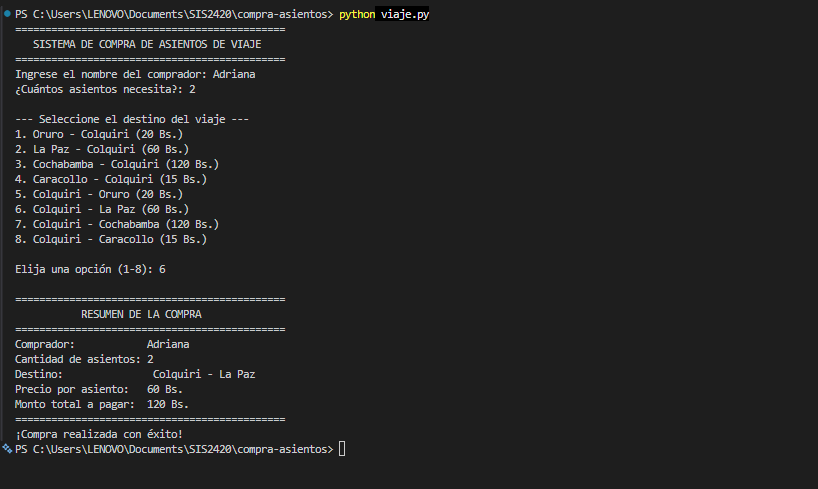

# Manual de Usuario - Sistema de Compra de Asientos

## 1. Propósito
Este manual orienta al usuario paso a paso en el proceso de compra de pasajes y cálculo de tarifas a través de la consola del sistema.

## 2. Pasos para la ejecución del sistema
1. Abrir la consola o terminal del sistema operativo.
2. Navegar hasta la ubicación del proyecto.
3. Iniciar el programa mediante el comando `python viaje.py`.

## 3. Instrucciones de uso

### Paso 1: Ingreso del nombre
- Cuando la pantalla solicite `Ingrese el nombre del comprador:`, escriba su nombre completo y presione `Enter`.

### Paso 2: Especificar la cantidad de asientos
- Ingrese en números enteros la cantidad de pasajes que necesita comprar (debe ser un valor mayor a 0).

### Paso 3: Selección de la ruta de viaje
- Observe la lista de los 8 destinos disponibles con sus respectivas tarifas por pasaje:
  1. Oruro - Colquiri (20 Bs.)
  2. La Paz - Colquiri (60 Bs.)
  3. Cochabamba - Colquiri (120 Bs.)
  4. Caracollo - Colquiri (15 Bs.)
  5. Colquiri - Oruro (20 Bs.)
  6. Colquiri - La Paz (60 Bs.)
  7. Colquiri - Cochabamba (120 Bs.)
  8. Colquiri - Caracollo (15 Bs.)
- Digite el número de la opción elegida (1 al 8) y presione `Enter`.

## 4. Resultado esperado
El sistema desplegará en pantalla un recuadro con el **Resumen de la Compra**, indicando:
- Nombre del comprador.
- Cantidad de asientos.
- Ruta o destino elegido.
- Tarifa individual.
- **Monto total a pagar (Bs.).**

## 5. Problemas comunes y soluciones
- **Problema 1:** Error al ingresar letras en la cantidad de asientos o en la opción.
  - Causa: se introdujeron caracteres de texto en un campo numérico.
  - Solución: el programa mostrará el mensaje `Entrada inválida` y volverá a pedir el dato. Ingrese un número entero.
- **Problema 2:** El comando `python` no se reconoce en la terminal.
  - Causa: Python no está instalado o no está agregado a las variables de entorno (`PATH`).
  - Solución: verifique la instalación con `python --version` o utilice el comando `python3 viaje.py`.

## 6. Evidencia del sistema

